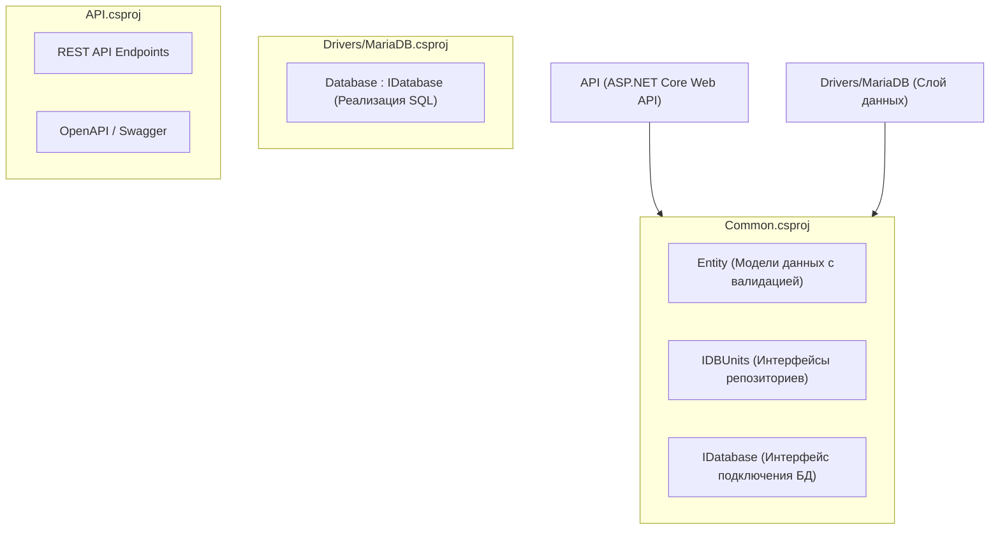
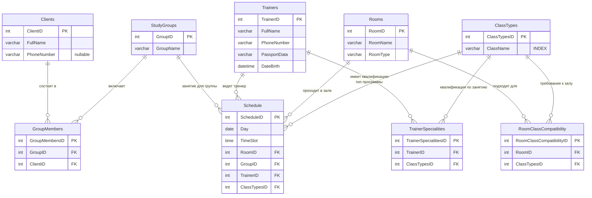

# Карта проекта «С#kurs» (Система управления фитнес-центром и расписанием)

---

## 1. Архитектура решения

Проект построен по многослойной архитектуре с разделением ответственности на независимые проекты в составе единого решения (`API.slnx`).



---

## 2. Структура файлов и проектов

```text
С#kurs/
├── API.slnx                                # Файл решения .NET
├── PROJECT_MAP.md                          # Карта и документация проекта
│
├── Common/                                 # [Слой абстракций и моделей]
│   ├── Common.csproj
│   ├── IDatabase.cs                        # Базовый интерфейс подключения к БД
│   └── DB/
│       ├── IDBUnits.cs                     # Обобщенный интерфейс репозитория IDBUnits<T>
│       │
│       ├── Entity/                         # Модели сущностей БД с валидацией
│       │   ├── Client.cs                   # Клиент (ФИО, телефон, валидация Regex)
│       │   ├── StudyGroup.cs               # Учебная группа (название, валидация)
│       │   ├── GroupMembers.cs             # Членство клиента в группе (M:N)
│       │   ├── Trainer.cs                  # Тренер (ФИО, телефон, паспорт, возраст)
│       │   ├── TrainerSpeciality.cs        # Квалификация тренера (M:N с типами занятий)
│       │   ├── ClassType.cs                # Тип занятия (йога, кроссфит и т.д.)
│       │   ├── Room.cs                     # Зал/помещение (название, тип зала)
│       │   ├── RoomClassCompatibility.cs   # Совместимость зала и занятия (M:N)
│       │   └── Sсhedule.cs                 # Расписание (дата, время, зал, группа, тренер, занятие)
│       │
│       └── IDBUnits/                       # Интерфейсы доступа к данным (CRUD + запросы)
│           ├── IClient.cs                  # Контракт операций для клиентов
│           ├── IStudyGroup.cs              # Контракт операций для учебных групп
│           ├── IGroupMembers.cs            # Контракт операций для состава групп
│           ├── ITrainer.cs                 # Контракт операций для тренеров
│           ├── ITrainerSpeciality.cs       # Контракт операций для специальностей
│           ├── IClassType.cs               # Контракт операций для типов занятий
│           ├── IRoom.cs                    # Контракт операций для залов
│           ├── IRoomClassCompatibility.cs  # Контракт операций совместимости залов
│           └── ISсhedule.cs                # Контракт операций для расписания
│
├── Drivers/                                # [Слой драйверов и работы с СУБД]
│   ├── MariaDB/
│   │   ├── MariaDB.csproj
│   │   └── Database.cs                     # Реализация работы с MariaDB/MySQL
│   └── SQLite/
│       ├── SQLite.csproj
│       ├── Database.cs                     # Реализация работы с SQLite
│       └── Initialization/                 # C#-классы декомпозиции инициализации таблиц
│           ├── ITableInitializer.cs        # Интерфейс инициализатора таблицы
│           ├── DatabaseInitializer.cs      # Координатор порядка инициализации таблиц
│           ├── ScheduleInitializer.cs      # [FK] Таблица расписания
│           ├── GroupMembersInitializer.cs  # [FK] Таблица состава групп
│           ├── TrainerSpecialitiesInitializer.cs # [FK] Квалификации тренеров
│           ├── RoomClassCompatibilityInitializer.cs # [FK] Совместимость залов
│           ├── ClientsInitializer.cs       # Базовая: Клиенты
│           ├── StudyGroupsInitializer.cs   # Базовая: Учебные группы
│           ├── TrainersInitializer.cs      # Базовая: Тренеры
│           ├── ClassTypesInitializer.cs    # Базовая: Типы занятий
│           └── RoomsInitializer.cs         # Базовая: Залы
│
└── API/                                    # [Слой веб-сервиса / REST API]
    ├── API.csproj
    ├── Program.cs                          # Точка входа, настройка DI, OpenAPI, роутов
    ├── appsettings.json                    # Конфигурация (строки подключения, логирование)
    └── API.http                            # Файл для тестирования HTTP-запросов
```

---

## 3. Схема базы данных (ER-Диаграмма)



---

## 4. Сводная таблица компонентов

| Сущность БД | Модель (Entity) | Интерфейс репозитория | Связи (FK / Индексы) | Ключевые операции |
| :--- | :--- | :--- | :--- | :--- |
| **Clients** | [Client](file:///c:/Users/Пользователь/Desktop/С#kurs/Common/DB/Entity/Client.cs) | [IClient](file:///c:/Users/Пользователь/Desktop/С#kurs/Common/DB/IDBUnits/IClient.cs) | 1:N к `GroupMembers` | CRUD, `GetByPhoneNumber`, `SearchByFullName`, `GetByGroupId`, `Exists` |
| **StudyGroups** | [StudyGroup](file:///c:/Users/Пользователь/Desktop/С#kurs/Common/DB/Entity/StudyGroup.cs) | [IStudyGroup](file:///c:/Users/Пользователь/Desktop/С#kurs/Common/DB/IDBUnits/IStudyGroup.cs) | 1:N к `GroupMembers`, `Schedule` | CRUD, `GetByName`, `GetByClientId`, `GetByTrainerId`, `GetMembersCount` |
| **GroupMembers** | [GroupMembers](file:///c:/Users/Пользователь/Desktop/С#kurs/Common/DB/Entity/GroupMembers.cs) | [IGroupMembers](file:///c:/Users/Пользователь/Desktop/С#kurs/Common/DB/IDBUnits/IGroupMembers.cs) | FK: `GroupID`, `ClientID` | CRUD, `GetByGroupId`, `GetByClientId`, `IsClientInGroup`, `Add/Remove` |
| **Trainers** | [Trainer](file:///c:/Users/Пользователь/Desktop/С#kurs/Common/DB/Entity/Trainer.cs) | [ITrainer](file:///c:/Users/Пользователь/Desktop/С#kurs/Common/DB/IDBUnits/ITrainer.cs) | 1:N к `TrainerSpecialities`, `Schedule` | CRUD, `GetByPhoneNumber`, `GetByClassTypeId`, `IsTrainerAvailable` |
| **TrainerSpecialities** | [TrainerSpeciality](file:///c:/Users/Пользователь/Desktop/С#kurs/Common/DB/Entity/TrainerSpeciality.cs) | [ITrainerSpeciality](file:///c:/Users/Пользователь/Desktop/С#kurs/Common/DB/IDBUnits/ITrainerSpeciality.cs) | FK: `TrainerID`, `ClassTypesID` | CRUD, `GetByTrainerId`, `GetByClassTypeId`, `HasSpeciality`, `Add/Remove` |
| **ClassTypes** | [ClassType](file:///c:/Users/Пользователь/Desktop/С#kurs/Common/DB/Entity/ClassType.cs) | [IClassType](file:///c:/Users/Пользователь/Desktop/С#kurs/Common/DB/IDBUnits/IClassType.cs) | Index: `ClassName` | CRUD, `GetByName`, `SearchByName`, `GetByTrainerId`, `GetByRoomId` |
| **Rooms** | [Room](file:///c:/Users/Пользователь/Desktop/С#kurs/Common/DB/Entity/Room.cs) | [IRoom](file:///c:/Users/Пользователь/Desktop/С#kurs/Common/DB/IDBUnits/IRoom.cs) | 1:N к `RoomClassCompatibility`, `Schedule` | CRUD, `GetByName`, `GetByType`, `GetCompatibleRooms`, `IsRoomAvailable` |
| **RoomClassCompatibility** | [RoomClassCompatibility](file:///c:/Users/Пользователь/Desktop/С#kurs/Common/DB/Entity/RoomClassCompatibility.cs) | [IRoomClassCompatibility](file:///c:/Users/Пользователь/Desktop/С#kurs/Common/DB/IDBUnits/IRoomClassCompatibility.cs) | FK: `RoomID`, `ClassTypesID` | CRUD, `GetByRoomId`, `GetByClassTypeId`, `IsCompatible`, `Add/Remove` |
| **Schedule** | [Sсhedule](file:///c:/Users/Пользователь/Desktop/С#kurs/Common/DB/Entity/Sсhedule.cs) | [ISсhedule](file:///c:/Users/Пользователь/Desktop/С#kurs/Common/DB/IDBUnits/ISсhedule.cs) | Index: `[Day, TimeSlot, TrainerID]`, `[Day, TimeSlot, GroupID]` | CRUD, `GetByTrainerSlot`, `GetByGroupSlot`, `IsTrainerBusy`, `IsRoomOccupied`, выборки дат |

---

## 5. Дорожная карта реализации проекта

1. [x] **Проектирование сущностей**: создание классов сущностей `Entity` с инкапсуляцией и регулярными выражениями валидации.
2. [x] **Проектирование контрактов БД**: объявление всех функций в `IDBUnits` по диаграмме БД (CRUD + выборки по FK/индексам).
3. [x] **Настройка архитектуры сборки**: единый солюшен `API.slnx`, связывающий `Common`, `MariaDB` и `API`.
4. [ ] **Реализация драйвера СУБД**:
   - Написание SQL-запросов и методов доступа в проекте `Drivers/MariaDB` с использованием ADO.NET / Dapper / Pomelo.
   - Подключение пула соединений через строку подключения в `appsettings.json`.
5. [ ] **Слой Web API**:
   - Регистрация зависимостей в DI-контейнере (`Program.cs`).
   - Создание контроллеров / Minimal API эндпоинтов для взаимодействия с клиентом.
   - Подключение валидации входных данных и обработки ошибок.
