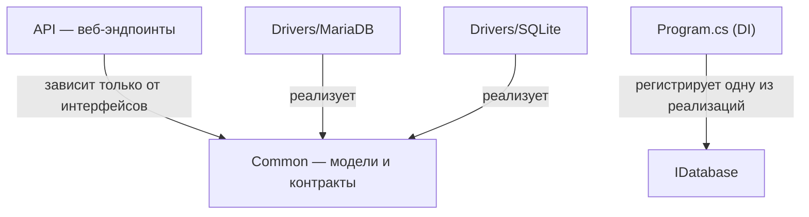

# С#kurs — Система управления фитнес-центром и расписанием

Серверное приложение (ASP.NET Core Web API) для управления клиентами, тренерами, залами, учебными группами и расписанием занятий фитнес-центра.

---

## 1. Стек технологий и чем он обусловлен

| Технология | Что это | Почему выбрана |
| :--- | :--- | :--- |
| **C# / .NET 10** | Язык и платформа выполнения | Единый язык на всех слоях — от моделей сущностей до веб-эндпоинтов. Строгая типизация + валидация данных прямо в моделях (регулярные выражения в сеттерах свойств) отсекают некорректные данные до попадания в БД |
| **ASP.NET Core Web API** | Веб-фреймворк | Готовая инфраструктура REST-эндпоинтов, встроенный DI-контейнер, OpenAPI/Swagger для документации и интерактивной проверки API без сторонних инструментов |
| **ADO.NET (без ORM)** | Доступ к данным через `MySqlConnector` / `Microsoft.Data.Sqlite` | Прямой контроль над SQL-запросами и схемой БД. ORM (EF Core/Dapper) сознательно не используется: проект учебный, цель — работа с SQL напрямую, а запросы проекта (проверки занятости тренера/зала, выборки по FK) просты и прозрачно выражаются на чистом SQL |
| **MariaDB + драйвер MySqlConnector** | Основная СУБД | Полноценный сервер БД для эксплуатации: транзакции (InnoDB), внешние ключи, индексы, многопользовательский доступ. `MySqlConnector` — современный асинхронный ADO.NET-драйвер для MySQL/MariaDB |
| **SQLite + Microsoft.Data.Sqlite** | Резервная СУБД | Встраиваемая БД в одном файле (`MyDataBase.db`) — без установки сервера. Используется для локальной разработки, отладки и демонстрации: не нужен запущенный MariaDB-сервер |
| **Формат решения `.slnx`** | XML-описание решения | Новый формат .NET (вместо legacy `.sln`): читаемый XML, нативная поддержка в .NET SDK 9+/10 и Visual Studio 2022 17.13+ |

### Почему API не привязано к конкретной БД

Слой веб-API **не знает, какая СУБД под ним работает**. Это обеспечивается архитектурой:

1. **`Common` объявляет контракты, но не реализацию**: интерфейс `IDatabase` (фабрика репозиториев) и набор репозиториев `IDBUnits<T>` (`IClient`, `ITrainer`, `ISсhedule` и т.д.) описывают *что* можно делать с данными, но не *как*.
2. **`Drivers/*` реализуют контракты под конкретную СУБД**: проект `Drivers/MariaDB` — реализация `IDatabase` на MariaDB SQL, проект `Drivers/SQLite` — та же функциональность на SQLite. Оба драйвера взаимозаменяемы.
3. **Подключение через DI**: в `Program.cs` регистрируется одна реализация `IDatabase` (MariaDB или SQLite), и API работает только с интерфейсом. Смена СУБД = смена одной строки регистрации + строки подключения в `appsettings.json`, без изменений в коде эндпоинтов.

Такой подход позволяет разрабатывать и демонстрировать систему на SQLite без сервера, а в эксплуатации переключиться на MariaDB — API-слой при этом не меняется вообще.

---

## 2. Структура проекта: что в какой папке лежит

```text
C#kurs/
├── API.slnx                 # Решение: связывает все четыре проекта
├── README.md                # Этот файл — описание проекта
├── PROJECT_MAP.md           # Детальная карта компонентов и ER-диаграмма
│
├── Common/                  # [Библиотека] Абстракции и модели данных
│   ├── Common.csproj        #   Без зависимостей от СУБД — только чистый C#
│   ├── IDatabase.cs         #   Интерфейс-фабрика всех репозиториев системы
│   ├── MyDataBase.db        #   Файл базы SQLite (для резервного драйвера)
│   └── DB/
│       ├── IDBUnits.cs      #   Обобщённый интерфейс репозитория (CRUD-контракт)
│       ├── Entity/          #   Модели-сущности с валидацией в сеттерах
│       │   ├── Client.cs                     # Клиент (ФИО, телефон, адрес)
│       │   ├── StudyGroup.cs                 # Учебная группа
│       │   ├── GroupMembers.cs               # Состав групп (M:N клиент↔группа)
│       │   ├── Trainer.cs                    # Тренер (ФИО, телефон, паспорт, дата рождения)
│       │   ├── TrainerSpeciality.cs          # Квалификации тренера (M:N)
│       │   ├── ClassType.cs                  # Тип занятия (йога, кроссфит…)
│       │   ├── Room.cs                       # Зал / помещение
│       │   ├── RoomClassCompatibility.cs     # Совместимость зала и занятия (M:N)
│       │   └── Sсhedule.cs                   # Расписание (дата, время, зал, группа, тренер, занятие)
│       └── IDBUnits/        #   Контракты доступа к данным (по одному на сущность)
│           ├── IClient.cs, IStudyGroup.cs, IGroupMembers.cs,
│           ├── ITrainer.cs, ITrainerSpeciality.cs, IClassType.cs,
│           └── IRoom.cs, IRoomClassCompatibility.cs, ISсhedule.cs
│
├── Drivers/                 # [Слой данных] Реализация контрактов под конкретные СУБД
│   ├── MariaDB/             #   Драйвер основной СУБД
│   │   ├── MariaDB.csproj   #     Зависимость: MySqlConnector
│   │   ├── Database.cs      #     Реализация IDatabase (в разработке)
│   │   └── scripts/         #     C#-скрипты инициализации схемы БД
│   │       ├── ITableInitializer.cs          # Интерфейс: инициализация одной таблицы
│   │       ├── DatabaseInitializer.cs        # Координатор (отключение FK-проверок, порядок таблиц)
│   │       ├── ClientsInitializer.cs         # Базовая таблица: клиенты
│   │       ├── StudyGroupsInitializer.cs     # Базовая: учебные группы
│   │       ├── TrainersInitializer.cs        # Базовая: тренеры
│   │       ├── ClassTypesInitializer.cs      # Базовая: типы занятий
│   │       ├── RoomsInitializer.cs           # Базовая: залы
│   │       ├── GroupMembersInitializer.cs    # FK: состав групп (M:N)
│   │       ├── TrainerSpecialitiesInitializer.cs  # FK: квалификации тренеров
│   │       ├── RoomClassCompatibilityInitializer.cs # FK: совместимость залов
│   │       └── ScheduleInitializer.cs        # FK: расписание (4 внешних ключа)
│   └── SQLite/              #   Драйвер резервной СУБД (та же функциональность)
│       ├── SQLite.csproj    #     Зависимость: Microsoft.Data.Sqlite
│       ├── Database.cs      #     Реализация IDatabase на SQLite
│       └── Initialization/  #     Аналог scripts/: инициализация таблиц SQLite
│
└── API/                     # [Веб-слой] ASP.NET Core Web API
    ├── API.csproj           #   Зависимости: ASP.NET Core, OpenAPI
    ├── Program.cs           #   Точка входа: конфигурация DI, pipeline, эндпоинты
    ├── appsettings.json     #   Конфигурация: строки подключения к БД, логирование
    ├── appsettings.Development.json  # Переопределения для среды разработки
    ├── API.http             #   Готовые HTTP-запросы для ручного тестирования API
    └── Properties/          #   Настройки запуска (launchSettings.json: порты, профиль)
```

---

## 3. Логика слоёв (кто на кого ссылается)



Зависимость направлена **в одну сторону**: API → Common ← Drivers. Веб-слой и драйверы БД не знают друг о друге и связываются только через контракты `Common` в момент регистрации в DI-контейнере.

---

## 4. Схема базы данных

9 таблиц, 4 из них — связки M:N. Полная ER-диаграмма и сводная таблица операций — в [PROJECT_MAP.md](PROJECT_MAP.md).

- **Базовые (без FK):** `Clients`, `StudyGroups`, `Trainers`, `ClassTypes`, `Rooms`
- **Связки M:N (FK):** `GroupMembers` (группы↔клиенты), `TrainerSpecialities` (тренеры↔занятия), `RoomClassCompatibility` (залы↔занятия)
- **Агрегат (4 FK):** `Schedule` — расписание: дата, время, зал, группа, тренер, тип занятия; составные индексы `[Day, TimeSlot, TrainerID/GroupID/RoomID]` для проверок занятости

---

## 5. Сборка и запуск

```bash
dotnet build API.slnx        # собрать всё решение
dotnet run --project API     # запустить веб-API
```

Swagger/OpenAPI: `https://localhost:<port>/openapi/v1.json` (в среде Development).
